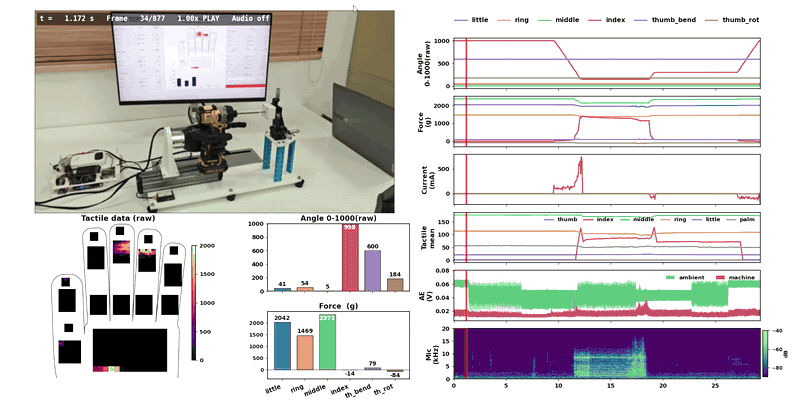
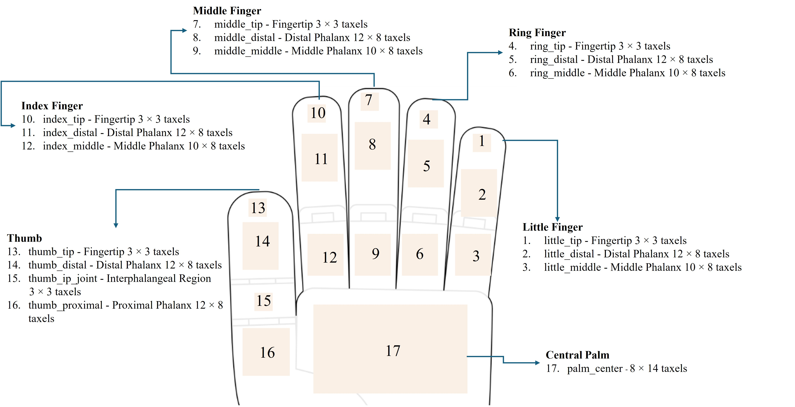

# Grasping a power tool with the RH56E2 dexterous hand — recording code and data

The Inspire-Robots RH56E2 hand holds a hand-held power tool with different finger
combinations (M = middle, R = ring, L = little; the thumb and the index finger, which
presses the trigger, are used in every grasp). Two experiments are included:

| Experiment | What happens | Grasps |
|---|---|---|
| **Load cell** | The hand, mounted on a linear guide, pushes the drill bit against a fixed load cell, so the drill is pushed back into the hand along its axis (like the reaction force when drilling). | M, M+R, M+L, M+R+L |
| **Screw driving** | The hand drives an M4 screw with an electric screwdriver: the guide moves toward the work piece, the index finger presses the trigger, then releases and the guide retracts. | M, M+R+L |

## Overview

[](media/videos/dashboard_demo.mp4)

*Playback of one screw-driving run with the M+R+L grasp: webcam (top left), raw tactile map
(bottom left), finger position and force (bar charts), and the time series of every stream
on the same clock, including the two AE channels and the microphone. Click the image for the
full-resolution video.*

<p align="center">
  
</p>

*Tactile sensor regions of the RH56E2 hand: 17 pads with their names and taxel counts
(palm 8 × 14).*

## Repository layout

```
acquisition/        PC-side recording program (Python 3.10)
  Fingers_web_h5.py           main program: web dashboard + synchronized logging
  Finghers_control_h5_v2.py   hand control and HDF5 logging
  H1.py                       RH56E2 driver (Modbus TCP / serial)
  ae_board2.py, ae_ram_sampler.py   acoustic-emission board (screw test only)
  rig_boards.json             USB serial numbers of the two microcontroller boards
firmware/
  linear_guide_pico/          MicroPython for the board driving the linear guide and the load cell
data/
  loadcell/loadcell_3/        4 runs, one per grasp
  screw/M/, screw/MRL/        10 runs per grasp
media/
  photos/, videos/            set-up photos and example clips
```

## Hardware

- Inspire-Robots **RH56E2** hand, Modbus TCP (default `192.168.11.210:6000`)
- Linear guide driven by a stepper motor from a **Cytron Motion 2350 Pro** (RP2350, MicroPython),
  running `firmware/linear_guide_pico/snapmarker_linear_module.py`
- Load cell with an **HX711** on the same board (DT = GP17, SCK = GP16)
- USB webcam (640 × 480, 30 fps)
- Screw test only: two **AE-ENV24A10** acoustic-emission modules on a second Motion 2350 Pro
  (GP26, GP27). Not used in the paper.

The boards are found by USB serial number (`acquisition/rig_boards.json`), not by COM port.
Change the serial numbers there to match your own boards.

## Install

```bash
pip install -r requirements.txt
```

`opencv-python` (webcam) and `sounddevice` (microphone) are optional; the recorder turns those
features off when they are missing.

## Run the recorder

```bash
cd acquisition
python Fingers_web_h5.py                          # use all hardware that is connected
python Fingers_web_h5.py --demo                   # no hardware: simulated hand
python Fingers_web_h5.py --robot-ip 192.168.11.210 --camera 1
python Fingers_web_h5.py --help                   # all options
```

The dashboard opens in the browser. `log start` / `log stop` record one session: the hand,
guide, load cell (and AE) go into `hand.h5`, and the webcam into `video.mp4` in the same
session folder.

## Data format

Each session folder holds:

| File | Content |
|---|---|
| `hand.h5` | all sensor streams (below) |
| `video.mp4` | webcam, 640 × 480, 30 fps |
| `video.frames.csv` | `frame, timestamp, elapsed_s` for every video frame |
| `video.json` | video settings and clock description |

All timestamps are on one clock (`time.time()` of the recording PC, Unix seconds), so video frame
*k* matches the HDF5 sample whose `timestamp` is closest to `video.frames.csv` row *k*.

`hand.h5` groups:

| Group | Datasets | Notes |
|---|---|---|
| `/time` | `timestamp`, `elapsed_s`, `datetime`, `tactile_timestamp`, … | hand samples ≈ 16–19 Hz, tactile ≈ 4 Hz |
| `/index`, `/middle`, `/ring`, `/little` | `angle`, `pos`, `force_g`, `speed`, `current_mA`, `temp_C`, `status`, `error`, `tactile` | `angle`: position register, 1000 = open, 0 = closed; `force_g`: grams |
| `/thumb` | `bend`, `rot`, `tactile` | |
| `/palm` | `tactile` | raw taxel counts (uncalibrated) |
| `/guide` | `position_mm`, `position_steps`, `homed`, `timestamp`, `elapsed_s` | 50 Hz, open-loop commanded position (400 steps/mm) |
| `/loadcell` | `force_g`, `raw`, `timestamp`, `elapsed_s` | ≈ 11 Hz; `force_g = (raw − offset_counts) / counts_per_g`, both stored as attributes |
| `/ae` | `data`, frame timing | screw test only; 20 kHz per channel, 12-bit counts of the 0–2 kHz AE **envelope**. Conversion and clock are in the group attributes |
| `/marks` | | manual event marks (empty in most sessions) |

File-level attributes record the start/end time, the number of samples and the finger order
(`little, ring, middle, index, thumb_bend, thumb_rot`).

AE channel mounting (the HDF5 attributes still say `UNSPECIFIED`): **ch0 (GP26) = base of the
screw plate, ch1 (GP27) = on the hand.**

## Sessions

**Load cell** (`data/loadcell/loadcell_3/`), recorded 21 Oct 2026: the guide pushes from 17 mm
to 25 mm at about 1 mm/s; every run starts contact at the same guide position.

| Grasp | Session |
|---|---|
| M | `session_20261021_190416m` |
| M+R | `session_20261021_191318mr` |
| M+L | `session_20261021_192438ml` |
| M+R+L | `session_20261021_191648mrl` |

**Screw driving** (`data/screw/`), recorded 27–28 Oct 2026, 10 runs per grasp.


## Contact

Jetnipat Thongprasith, Chulalongkorn University
